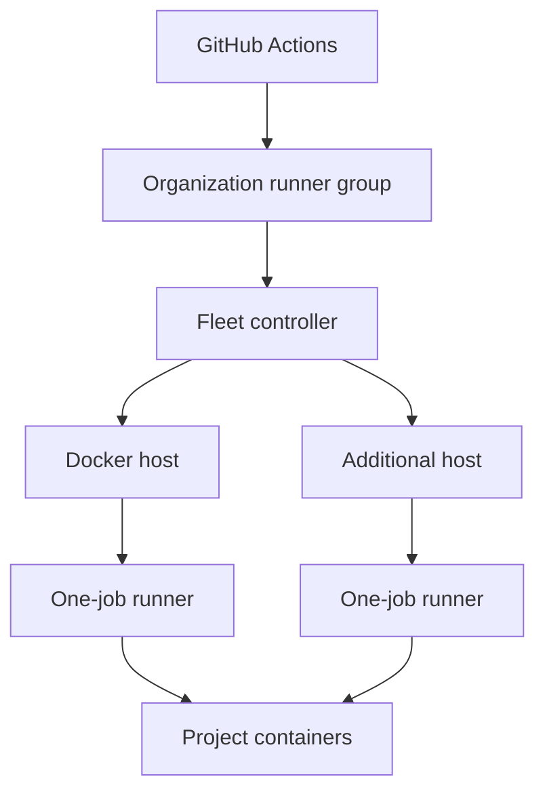
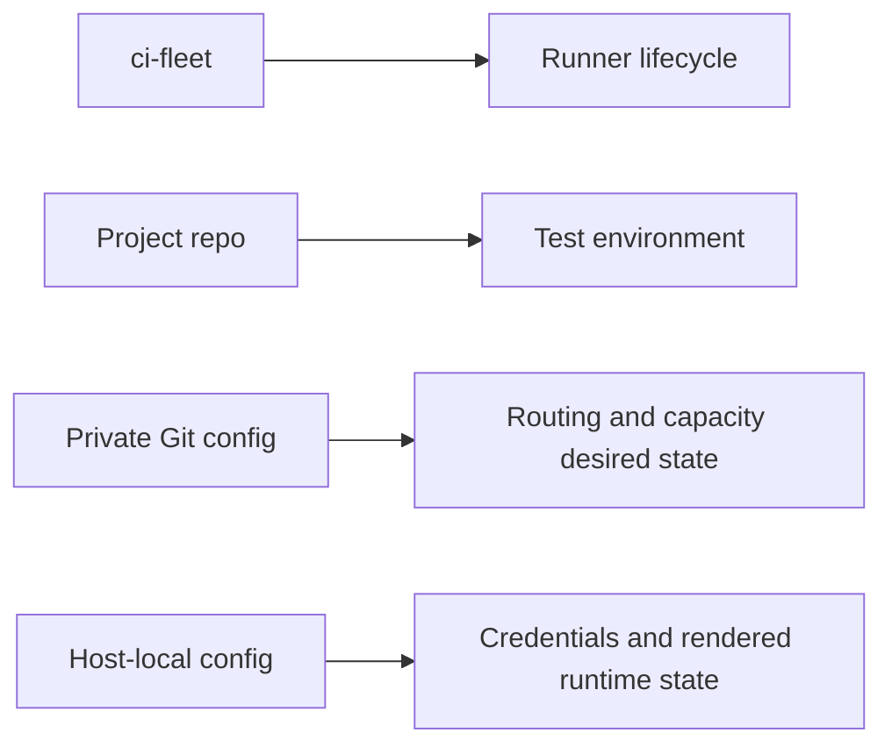
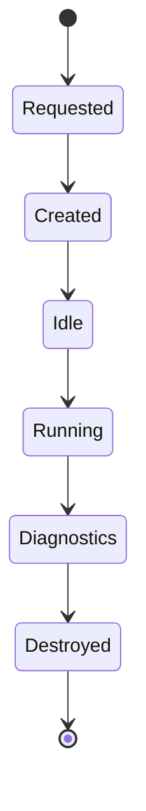
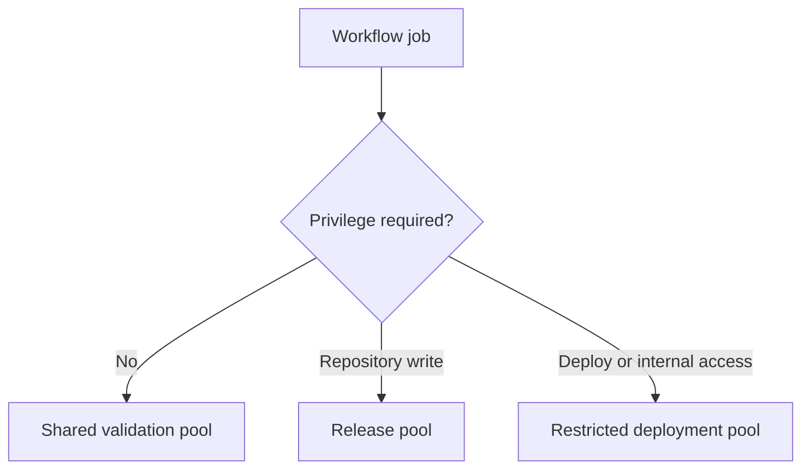
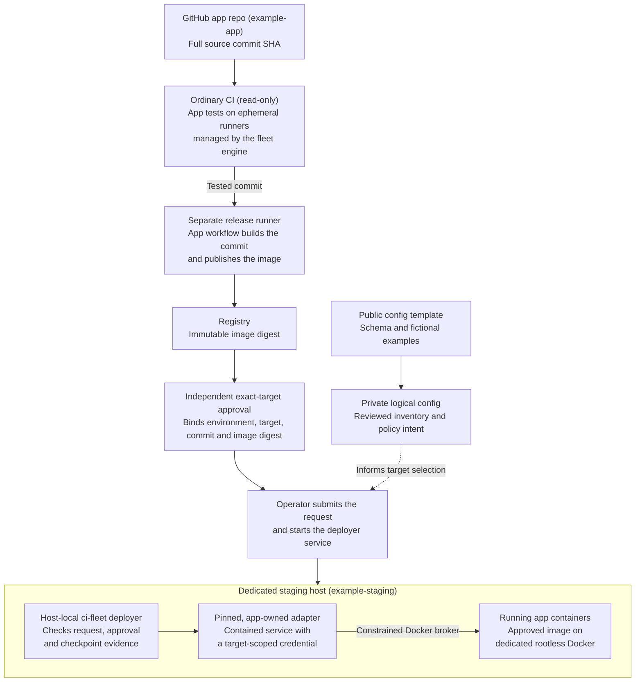
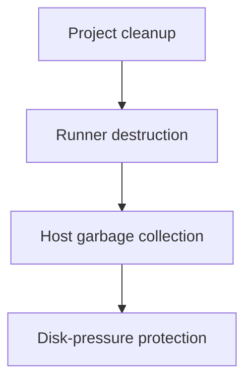

# Architecture

Status: design draft

## Objective

Provide a portable fleet of identical self-hosted GitHub Actions runners that can serve multiple explicitly authorized repositories. Each project owns its test environment; the fleet owns runner lifecycle, host maintenance, capacity, and common workflow behavior.

## Set-and-forget invariants

- A host is enrolled once with a unique instance and scale-set identity and a shared capability label.
- Host configuration and worker images contain no repository names, allowlists, project runtimes, or project test logic.
- GitHub runner-group policy authorizes repositories; private fleet configuration records intended organization policy.
- Adding or removing a project never requires changing, rebuilding, restarting, or re-registering a compatible host.
- Adding a location never requires changing a project workflow; GitHub routes its shared label to any healthy compatible scale set.
- Losing or draining one site leaves compatible work available to other sites.
- Privileged workloads remain on separate labels, groups, hosts, and network boundaries.

## System topology

A host may run multiple runners when resource measurements and project isolation permit it. Runners sharing a Docker daemon share one security boundary.

## Responsibility boundaries

### Fleet repository

The fleet is responsible for:

- runner image construction;
- organization-level runner routing;
- ephemeral runner creation and destruction;
- controller authentication;
- host bootstrap and validation;
- resource limits;
- health monitoring and external logs;
- safe garbage collection;
- unattended security maintenance;
- reusable workflow interfaces;
- hard project CI rules and onboarding documentation.

### Project repositories

Each project is responsible for:

- its test Dockerfile;
- its service definitions;
- the standard `scripts/ci/run.sh` entrypoint;
- its fast, full, smoke, and integration commands;
- test fixtures and migrations;
- project-specific secrets;
- run-scoped Compose names and resource labels;
- run-scoped cleanup;
- release and deployment behavior.

### Private installation configuration

Each installation is responsible for:

- real organization and runner-group names;
- logical controller identities and capacity budgets;
- pinned controller engine revisions;
- private network rules;
- required secret names;
- monitoring destinations;
- maintenance windows.

These secret-free values belong in a reviewed private schema-v3 configuration repository. Machine addresses, VM IDs, storage and backup identifiers, credentials, secret values, and rendered runtime files remain host-local or in an external secret manager. See [Git-authored controller desired state](DESIRED-STATE.md).

## Target runner lifecycle

1. The controller authenticates to GitHub using a GitHub App.
2. GitHub reports demand for the configured runner scale set.
3. The controller generates a short-lived just-in-time runner configuration.
4. The host creates an ephemeral runner container with defined resource limits.
5. The runner accepts one job.
6. The job launches the project-defined test containers.
7. Project cleanup removes only resources belonging to that workflow run.
8. Logs and failure diagnostics are retained outside the ephemeral runner.
9. The runner container and writable state are destroyed.
10. Capacity is reconciled against current demand.

## Job routing

Project-controlled inputs must not allow an ordinary validation job to select a privileged runner group.

## Application deployment path

An operator starts deployment by submitting an approved request on the target
host and starting the deployer service. A GitHub merge or passing CI run leaves
that step pending. The current path requires a separately authorized staging
target, including for previews. Production rollout is disabled.

The controller's GitHub App key stays outside all job containers. Release
publishing credentials stay in the release workflow. The private config records
logical targets and required secret names. The deployer reads protected policy,
credentials, and evidence on the target host. Its host and Docker daemon are
dedicated to deployment. See the
[secrets model](SECRETS.md) and [deployer runbook](DEPLOYER-HOST.md).

## Deployment shapes

The same fleet interface should support:

- one Docker host with one or more runners;
- several Docker hosts with one or more runners each;
- virtual machines;
- dedicated physical computers;
- remote-site computers;
- VPS infrastructure.

Kubernetes is not an initial requirement. The architecture should not prevent a later Kubernetes implementation.

## Cleanup layers

Host-wide pruning must not run as an uncoordinated per-job operation. Hard cancellation and host failure may bypass project traps, so resources must remain identifiable by run and age.

Job completion and the runner exit watcher can request removal of the same
container concurrently. If Docker reports that removal is already in progress,
the controller waits up to 30 seconds for that container's removal. Confirmed
removal or an already absent container lets processing continue. Other Docker
errors, cancellation and an expired wait remain cleanup failures.

The existing host cleanup timer also reclaims empty networks at least ten
minutes old whose allocations
lie entirely inside rendered Docker default address pools. This includes
unlabeled project Compose networks left after a failure. Controller networks,
the default bridge, and any network with an attached container remain intact.
An independent credential-free Docker socket proxy shares a maintenance gate
with cleanup. It completes dispatched reference mutations even after caller
cancellation. Cleanup takes the exclusive gate only after ordinary work is
idle; durable boot-scoped markers preserve uncertain operations across process
restarts. Raw host-root clients outside this gate and asynchronous orchestrators
are outside the ordinary fleet contract.
See [Network reclamation](HOST-MAINTENANCE.md#network-reclamation).

The host capacity service measures the Docker data root, runner workspace, and
upload spool. The controller reads only the protected measurement export and
uses it for [disk-pressure job admission](DISK-ADMISSION.md). Runner and project
containers have no mount for that export.

## Update layers

- Project runtime versions are controlled by project Dockerfiles.
- Runner versions are controlled by versioned fleet images.
- Host security updates are applied automatically.
- Reboots drain runner capacity before interrupting the host.
- Fleet updates use rolling replacement and an explicit rollback version.
- Controller routing, capacity, lifecycle, and engine updates use reviewed full commits from private desired-state configuration; hosts never follow an unreviewed moving branch.

## Endpoint observation

The [endpoint observation UI design](ENDPOINT-UI-DESIGN.md) defines an optional host service on loopback port 80, authenticated through an independently provisioned HTTPS gateway. The [read-only worker views](WORKER-VIEWS.md) read protected exports independently of Docker. Host installation, listener activation, and gateway integration are tracked in #122.

## Project adoption

All projects must follow the [Project CI Standard](PROJECT-STANDARD.md). Existing workflows must use the staged process in [Migrating Existing CI](MIGRATING-EXISTING-CI.md). Operators use [How to add a fleet host](ADDING-A-HOST.md) and [How to add a project](ADDING-A-PROJECT.md) without introducing project-specific host state.
