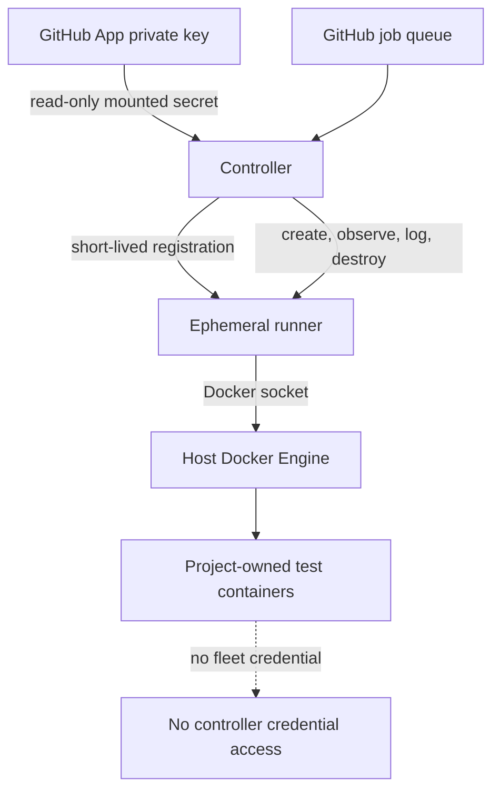

# Runner controller design

## Purpose

The controller turns GitHub job demand into disposable Dockerized GitHub Actions runners. It lets trusted private repositories share idle capacity without installing project runtimes directly on fleet hosts.

A persistent runner service per VM fragments capacity and retains job state. This controller instead creates one runner for one job and destroys it afterward.

## How it works

The controller:

1. authenticates to GitHub with a GitHub App;
2. watches demand for its uniquely named scale set;
3. generates short-lived just-in-time runner configuration;
4. creates a runner container with resource limits, rotated logs, ownership labels, and the Docker socket;
5. observes one assigned job;
6. retains final diagnostics outside the disposable runner;
7. destroys the runner and its writable state;
8. reconciles capacity with current demand.

Managed startup receives a full immutable runner runtime ID from the root
installer. It inspects that exact ID and requires its source revision and Linux
architecture to match the controller build. It creates runners with the same ID.
It does not read protected host image proof or export image layers. See
[managed images](MANAGED-IMAGES.md) for the config-to-runtime binding and legacy
source semantics.

On startup, it looks up its configured scale-set name in its configured runner group. It creates the set only when absent. If an existing set's name, group ID, and routing labels match, it opens a message session on that set, including after a power cut. It disables runner self-updates in place if needed so the reviewed runner image remains authoritative. A mismatch stops startup without changing or deleting the set. Graceful shutdown still deletes the selected set; startup and listener errors leave it available for another attempt.

On restart, it recovers only managed runners carrying the same fleet-instance and scale-set labels. Running, paused, and restarting runners remain intact, count against capacity, and resume completion and exit tracking. Until a completion event or container exit, it conservatively counts every surviving runner as busy because its job-start event may have already been acknowledged. Inactive leftovers are removed without force so a concurrent start cannot be killed. Startup and listener errors preserve active runners for the next attempt. It does not manage unrelated Docker workloads or another host's scale set.

The listener ignores late authenticated events for this instance's generated runner names only after Docker confirms their containers are gone; unrelated names and inspection errors still fail.

The pinned SDK also documents canceled scale-set assignments that never reach a runner. The controller ignores such a completion only when `result` is exactly `canceled`, `runnerName` is empty, `runnerId` is zero, `runnerAssignTime` is unset, the job ID is nonempty, and the runner request ID is positive. This conservative exception does not complete or remove any managed runner. Scaling continues to use the scale-set statistics. A blank runner name alone does not prove assignment cancellation.

Before handling a completion, the controller logs its result, runner name and ID, runner assignment time, job ID, runner request ID, and workflow run ID. Unknown or contradictory events and Docker inspection or cleanup errors still fail.

The pinned `actions/scaleset` 0.5.0 listener calls the controller's `Scale`
handler for initial statistics, each message batch, and empty polls. The handler
retains the latest assigned-job count so empty polls can replace exited runners
while demand remains. It acquires available jobs before processing starts and
completions, then reconciles capacity against the reported statistics. Reacquiring
an already acquired job is a service no-op.

The listener acknowledges a batch only after the handler succeeds. An acquisition,
callback, cleanup or acknowledgment failure stops the listener and leaves the
batch eligible for replay. Earlier effects in a partially completed batch can
repeat. Runner tracking remains until removal succeeds or the exit watcher
confirms removal, so failed cleanup can be retried. Replayed events for a removed
runner still require the instance-specific name check and Docker's confirmation
that the container is absent. Contradictory events and uncertain Docker results
remain failures; restarting alone does not fix their cause.

When Docker confirms that the exact tracked container ID is absent, the exit
watcher records its exit without issuing another removal. This avoids a duplicate
delete while a completion removal's response is still pending. Tracking remains
available until completion finishes; inspection and removal errors retain their
existing retry behavior.

A batch canceled before admission performs no work. Once admitted, a real batch
finishes acquisition, callbacks, cleanup and reconciliation without inheriting
caller cancellation, preserving the previous listener's cleanup behavior. The
SDK also acknowledges a successfully completed batch without caller cancellation.
Initial statistics and empty polls retain their caller's cancellation. Shutdown
and existing cleanup deadlines are unchanged.

For repeated `job completed for unknown runner ""` exits, compare the installed
engine's handler with the reviewed source before changing code or restarting.
An older handler without the unassigned-cancellation guard cannot distinguish
that documented event from a contradictory blank completion. If its logs omit
the completion fields above, the upstream event remains unclassified. After a
supported engine rollout, retain those diagnostics, verify representative jobs
start and complete, and verify runner cleanup and later reconciliation. Fixture
success and a running listener alone do not establish operational recovery.

## Security boundary

Docker socket access is host-root-equivalent. This pool is therefore limited to trusted repositories and trusted workflow revisions. Containers provide repeatability and cleanup; they do not make hostile workflow code safe.

The GitHub App private key exists only as a file-mounted controller secret. A runner receives only its short-lived registration configuration. Project secrets remain in GitHub repository or environment settings and are supplied only to jobs that explicitly require them.

## Choosing a runner model

ci-fleet is optimized for organizations that already operate Linux and Docker hosts, trust the repositories using the pool, and want idle capacity shared across projects. Other runner models may fit different requirements.

| Runner model | Good fit | Important tradeoff |
| --- | --- | --- |
| Persistent self-hosted runner | A small setup with one trusted repository and minimal orchestration | Workspaces and process state can survive between jobs, and idle capacity stays tied to that runner |
| Repository-specific runners sharing one host | Projects that require distinct GitHub registration or routing | Multiple services may compete for the same CPU, memory, disk, ports, and Docker daemon |
| Ephemeral Docker runners with ci-fleet | Multiple trusted repositories sharing Linux or Docker capacity across one or many locations | Runners are disposable, but jobs sharing a Docker daemon remain inside one host security boundary |
| Actions Runner Controller on Kubernetes | Organizations that already operate Kubernetes and want Kubernetes-native scaling | Requires a Kubernetes control plane and its associated operations |
| Disposable VM per job | Higher-isolation or higher-risk workloads | Stronger separation costs more startup time, storage, and provisioning infrastructure |
| GitHub-hosted runners | Teams that prefer managed capacity and do not require self-hosted resources or networks | Provides less control over hardware, locality, caching, and private infrastructure access |

The current controller pins the official `actions/scaleset` 0.5.0 client and
requires Go 1.27.3, including its pinned build image. Updates require a reviewed
build and live validation before rollout. Source validation does not establish
host acceptance.

## Operations and rollback

Hosts must be treated as disposable infrastructure, patched automatically, monitored for disk pressure, and restricted to trusted jobs.

To roll back an experimental controller:

1. stop new capacity;
2. confirm no managed job is active;
3. stop the controller;
4. run scoped cleanup for that fleet instance;
5. verify that host's scale set is absent from GitHub;
6. restore the last reviewed image and configuration if needed.

Existing project-specific CI remains available until migration validation is complete.
