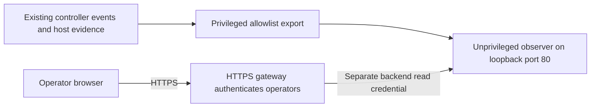

# Endpoint observation UI

Implementation status: planned. This ADR addresses [issue #117](https://github.com/RandomDevelopment/ci-fleet/issues/117). It adds no supported command, schema field, service, listener, or engine capability.

## Acceptance record

[PR #126](https://github.com/RandomDevelopment/ci-fleet/pull/126) is the durable acceptance record. The design is proposed while that PR is open and becomes accepted when the reviewed PR merges into `main`. Closing it without a merge leaves the design unaccepted. Its merge commit identifies the accepted design revision. Later changes require their own reviewed PRs. Design acceptance does not authorize installation, credentials, or network access.

## Decision and scope

Provide one optional, persistent observation UI per endpoint. Deliver the ordinary-CI worker first. It shows active work, health, enrollment evidence, approved configuration, and reasons the endpoint cannot accept more work. Keep worker, tester, deployer, and status-receiver roles separate.

Use an unprivileged host service independent of Docker. A privileged producer exports approved observations into a dedicated directory; the observer reads only those exports. The browser-facing service receives no Docker socket, GitHub App key, controller token, deployment credential, shell, or arbitrary host-file access.

Observation does not edit configuration, enroll a host, approve a change, cancel a job, drain, reset, deploy, repair, prune, or retire recovery guards. Those actions need separate reviewed contracts. Git-authored worker desired state, protected role policy, and existing approval gates remain authoritative.

The UI must remain available during controller restart, scale-to-zero, runner destruction, and Docker daemon failure. It may display stale or unavailable observations during those failures. A stopped host, failed host filesystem, or lost network requires the independent fleet monitor. Observer failure must not alter runner handling, cleanup, reconciliation, or existing resource-admission gates.

## Access on port 80

The initial observer binds only `127.0.0.1:80`. Systemd socket activation supplies the listener to the unprivileged service; the service needs no root identity or bind capability. Never replace an existing listener to claim the port.

An independently provisioned HTTPS gateway authenticates operators and authorizes access to all operational metadata on that endpoint. Reuse the installation's approved identity provider. The gateway forwards to the loopback observer on the same host. A gateway elsewhere requires an already approved encrypted transport terminating on that host; this design adds no remote bind or tunnel service.

The observer requires its own backend read bearer on every request, including assets and API reads. The gateway strips client-supplied authentication and identity headers, then injects that bearer. The observer compares the bearer in constant time and ignores `Remote-User`, `X-Forwarded-User`, and other identity claims. Reaching loopback or forging headers never grants access. This also prevents another unprivileged host user from bypassing gateway authentication.

Generate 32 random bytes and encode them as unpadded base64url for a separate 43-character backend bearer through authorized secret provisioning. Store those exact ASCII bytes without a trailing newline in protected host-local files readable by the intended gateway and observer services, using separate mode-`0600` copies. Never reuse GitHub, reporting, deployment, or receiver-read credentials. Rotation revokes the old value at the observer before activating the new gateway copy; a temporary observation outage is acceptable. Credential contents, authorization headers, and request query strings must not enter logs.

The browser receives no backend bearer, signing material, or receiver token. Its session remains at the HTTPS gateway. Do not put credentials in URLs, assets, browser storage, or unprotected HTTP. Limit initial access to fleet operators already authorized to see every repository and job on that endpoint; per-project sharing is separate work.

The worker installer does not enable SSH, create firewall rules, install a gateway, or expose remote ingress. [Bootstrap's authenticated temporary callback](DESIGN-DECISIONS.md#authenticate-the-bootstrap-callback-through-ssh) remains separate. A management-interface bind, direct browser login on HTTP port 80, or different tunnel authorization model requires a new accepted decision and proof of bypass resistance.

## Local exports and read API

Use a non-symlink directory at `/var/lib/ci-fleet/observer/exports`, owned by root and the dedicated observer group with mode `0750`. Snapshot and job exports are root-owned regular files with mode `0640`. Atomic publication uses a protected temporary file in the same directory. Readers validate ownership, type, size, schema, and source identity before accepting data. Never widen permissions on existing root-only installation, bootstrap, capacity, or recovery stores.

The producer reads only the existing role's approved evidence. It must not follow web-supplied paths, execute commands supplied by a request, or copy arbitrary logs. Its controller event input uses a protected channel; do not add private job metadata to the existing broadly readable controller-status file.

The producer checks for updated controller status and protected job-event evidence every 30 seconds, independently of the five-minute health timer. It copies existing health/capacity observations without rerunning those probes or increasing outbound reporting. Source reads have bounded timeouts; slow or failed sources remain unavailable or stale without delaying runner handling or other exports. Copying a source never refreshes its original observation time.

The observer exposes authenticated `GET` and `HEAD` reads for a fixed endpoint summary, paginated jobs, approved capacity aggregates, and diagnostic preview/export. Other methods fail without side effects. Job pages contain at most 100 records. Responses and diagnostic exports are capped at 1 MiB, use `Cache-Control: no-store`, and have no cross-origin access. Use fixed routes and opaque pagination cursors, never a URL proxy or file browser.

Render metadata as text, reject unsafe links, and use a restrictive content-security policy. No untrusted HTML, inline execution, arbitrary attachment preview, or raw log streaming is included. The gateway owns user-access auditing; endpoint logs use controlled request/error codes and omit job contents and authentication material.

## Snapshot version 1

This is the contract to implement in [#118](https://github.com/RandomDevelopment/ci-fleet/issues/118), not a new version of [status-report v1](STATUS-REPORTING.md). Limit the complete local snapshot to 64 KiB. Reject unknown schema versions and unapproved fields.

| Group | Approved observations |
| --- | --- |
| Envelope | Schema version, endpoint role, logical controller identity, boot time, publication time |
| Source evidence | Source version, availability state, actual observation time, last successful observation time, controlled failure code |
| Installation | Installed, absent, or unknown state; lifecycle; installed-at time; supported contract versions |
| Configuration | Desired/applied commits, pool, routing labels, reviewed maximum, CPU/memory limits, approved maintenance flags |
| Revisions | Desired engine, installed runtime, running controller, installed/staged manager, architecture, image-verification state and time |
| Enrollment | Separate identity-presence, authentication, scale-set match, listener readiness, reporting, and owner-confirmation evidence |
| Runtime and health | Verified runner counts, admission restrictions, Docker availability, redacted checks, existing resource measurements and timer states |
| Reconciliation | State, check time, last-success time, desired/applied commits, trusted transaction phase/outcome |
| Diagnostics | Controlled component/code, observation time, recovery status, fixed repository runbook reference |

Each source distinguishes `available`, `not_configured`, `unsupported`, `unavailable`, and `unknown`. Freshness is separate from availability. Missing numeric observations are absent, never zero. A retained last-success value carries its original time and cannot be presented as a current observation after collection fails.

The current `health/latest.json` stores redacted check results, not every raw probe measurement. Controller status publishes identity, version, counts, and time. Some existing health helpers substitute zero counts or capacity after failed reads, and may substitute a configured engine revision for an unavailable running revision. The new export must retain probe validity and provenance rather than treating those fallbacks as verified measurements. An unsupported producer supplies unknown evidence until its implementation exists.

An installed credential proves presence only. A running process proves process state only. Listener readiness, GitHub authentication, scale-set identity, image content, and applied configuration require their own evidence. A matching image label does not prove a reviewed image ID. A staged manager upgrade does not prove runtime activation. GitHub App visibility remains an owner confirmation because the API does not attest it.

Do not export raw desired-state files, rendered environments, protected trust policy, private endpoints, host inventory, proxy/`NO_PROXY` values, secret paths, arbitrary exception text, or reconciliation's free-text message. Maintenance and APT-cache settings may expose approved configured/absent/invalid state only. Reports and logs are not automatic redaction sources.

## Freshness and failure interpretation

Use Unix-second observation times from trusted producers. File modification time, export publication time, and browser refresh time do not refresh evidence. Reject invalid or implausibly future source timestamps and display clock uncertainty when the host clock is unsynchronized or moves backward.

| Source | Current cadence and initial stale threshold |
| --- | --- |
| Controller counts/readiness | Status refreshes every minute and on lifecycle events; stale after 120 seconds |
| Health and scheduled reconciliation | Normally every five minutes; stale after 900 seconds |
| Capacity | Every 30 seconds while runners are active; stale active sampling after 120 seconds; idle sampling is intentionally paused |
| Installation, policy, owner confirmation | Event-driven evidence; show recorded time and binding to the current identity/revision, never claim a recent live check from an old record |

Thresholds label observations; they do not modify existing health thresholds, timers, or reporting rates. Browser polling is no faster than every five seconds, stops when the view is hidden, and backs off after failure.

Keep intentional drain, blocked admission, process failure, stale evidence, and unknown readiness distinct. Show controlled reasons for network reserve, missing inspection, maintenance, or other gates only when an authoritative producer supplies them. A successful systemd invocation does not prove successful reconciliation. Missing transaction evidence cannot prove that nothing changed or that rollback succeeded.

## Job history version 1

[Issue #119](https://github.com/RandomDevelopment/ci-fleet/issues/119) records an allowlisted history through the existing authenticated scale-set listener. Observation does not change scaling, message acknowledgement, or runner cleanup and creates no competing message consumer.

| Field group | Contract |
| --- | --- |
| Identity | Logical controller and scale-set identity plus opaque scale-set `JobID`; keep GitHub's numeric REST job ID separate |
| Display | Validated owner/repository, display name, workflow run ID, runner association |
| Timing | Source queue/assignment/finish times when supplied; local start/completion observation times with provenance |
| Outcome | Observed running/completed/unknown state, normalized result, controlled evidence-gap code |
| Optional correlation | Run attempt, task, shard, or exact GitHub job ID only when independently verified |

Validate identifiers and cap each display name at 512 UTF-8 bytes. Display truncation must be explicit. Keep each serialized record at or below 4 KiB. Generate GitHub run links from validated owner/repository/run ID on the installation's approved GitHub origin. Never assume string `JobID` is the numeric REST job ID or parse arbitrary display names into trusted task/shard identity.

Keep no more than seven days or 5,000 records, and cap the whole private job store at 32 MiB including indexes, journals, and temporary files. Whichever bound is reached first wins. Sweep expiry even while idle. Protect private writable history with a root-owned mode-`0700` directory and mode-`0600` files; the browser reads only the bounded exports.

An observation queue is bounded and must drop excess observation work rather than block the listener. Count and expose event loss, retention truncation, corruption, and capped coverage explicitly. Excess storage writes fail independently; they never stop a job or weaken host disk admission. The UI must not imply that its retained list covers every active runner when evidence is incomplete.

Duplicate and late events cannot regress a verified terminal outcome. A recovered runner can have an unknown job association. A runner exit alone does not prove job completion, cancellation, timeout, or test failure. Missing completion stays unknown until independent evidence supplies a result; expiry is data retention, not a successful job result. Scope demand counts to the observed scale set, never the entire fleet.

Optional repository Actions-read enrichment requires a separate credential/access decision. The initial view uses listener metadata and GitHub run links without broadening the controller App's repository access.

## Capacity, diagnostics, and central reporting

Reuse the [anonymous local capacity history](CAPACITY-TELEMETRY.md) and its weekly aggregate. Keep its existing eight-day retention and record bounds. Export bounded chart/aggregate results through the privileged producer, without granting the observer access to the private history or correlating anonymous runner samples to jobs.

[Issue #120](https://github.com/RandomDevelopment/ci-fleet/issues/120) presents controlled diagnostics. It consumes trusted rejection phase and sanitized reason from [#110](https://github.com/RandomDevelopment/ci-fleet/issues/110). Distinguish rejection before a transaction, verified rollback, uncertain interruption, and unverified rollback. Preserve outstanding-operation guards and maintenance uncertainty. A diagnostic download contains only the displayed allowlist, includes a preview, and stays within the response limit above. Full job and controller log access is separate work.

The [central console in #123](https://github.com/RandomDevelopment/ci-fleet/issues/123) consumes the separately deployed authenticated receiver and reviewed expected inventory. Preserve outbound-only reporting, signed status-report v1, reporting rate, redaction, and retention. It receives no local job history or capacity samples. Its backend read token stays server-side.

The current receiver read API returns report payloads and their generation times. It does not expose database receipt time. Receipt-age display requires a separately versioned authenticated read-response extension without changing the signed report payload. Worker-local monitoring does not depend on receiver activation.

## Optional policy and compatibility

The implementation will add an `endpoint_observation_ui` engine capability and an optional per-controller `endpoint_ui` declaration with `enabled: true` and the fixed access reference `/etc/ci-fleet/observer/access.json`. Absence means disabled. That access file contains only protected references to the backend credential and approved gateway provisioning evidence. Real gateway endpoints, addresses, credentials, and identity-provider settings remain host-local or externally managed.

These names describe a future implementation contract. Current schema-v3 validators reject that new field, and current engines do not declare the capability. This design PR changes neither. Implement schema, validation, rendering, capability checks, and installation together under [#122](https://github.com/RandomDevelopment/ci-fleet/issues/122); never use a host-local switch to bypass reviewed worker desired state.

Follow the staged [desired-state capability rollout](DESIRED-STATE.md#schema-v3): first upgrade to and verify a supporting engine while UI policy is absent, then record its reviewed capability evidence, then enable policy using prior-state evidence. Preserve [independent configuration review](CONFIGURATION-APPROVAL.md). Prepare gateway/access credentials out of band before enablement. No listener starts with missing, unsafe, or unverified access configuration.

The installer validates policy, exports, access files, port ownership, and role admission before activation. It uses existing installation and role locks and preserves interrupted transactions and checkpoints. Committed disablement, uninstall, or downgrade to an unsupported engine removes the observer listener, exports, and fleet-owned private job history, including its indexes, journals, and temporary files. Do not leave private metadata behind after its retention sweeper stops. Existing role recovery records and operator-owned access policy/credentials stay retained for explicit disposition. A failed transition preserves the incumbent observer, bounded history, and CI state for rollback. Remove UI policy before selecting an engine that cannot validate it.

Version local exports and read responses independently. Unsupported contracts fail closed for observation while ordinary CI continues under its existing gates. A supporting observer cannot read a newer or malformed export by guessing field meanings. Preserve legacy behavior when UI policy is absent. Observer resource exhaustion must fail independently; host-wide resource failure may still affect CI.

## Role follow-ups and delivery gates

| Work | Dependency and boundary |
| --- | --- |
| [#118 snapshots](https://github.com/RandomDevelopment/ci-fleet/issues/118) and [#119 history](https://github.com/RandomDevelopment/ci-fleet/issues/119) | Implement the approved local contracts, with source validity and bounded independent failure |
| [#120 diagnostics](https://github.com/RandomDevelopment/ci-fleet/issues/120) and [#121 worker UI](https://github.com/RandomDevelopment/ci-fleet/issues/121) | Consume the contracts; missing upstream failure evidence stays unknown |
| [#122 packaging](https://github.com/RandomDevelopment/ci-fleet/issues/122) | Build on the accepted [worker desired-state lifecycle](DESIRED-STATE.md). At the review introducing this ADR, #69/#76 proposed additional role-admission changes and #74 proposed reviewed-image changes; none was an accepted dependency. Check their current state, coordinate overlap, and incorporate those contracts only after acceptance; preserve existing CI and separately authorized host proof |
| [#123 fleet console](https://github.com/RandomDevelopment/ci-fleet/issues/123) | Follow [#66 receiver deployment](https://github.com/RandomDevelopment/ci-fleet/issues/66), with no inbound worker polling |
| [#124 tester](https://github.com/RandomDevelopment/ci-fleet/issues/124) | Follow accepted tester contracts; show environment health, immutable revisions, expiry and recovery; preserve application ingress and forbid reset/removal |
| [#125 deployer](https://github.com/RandomDevelopment/ci-fleet/issues/125) | Follow accepted deployer contracts; show target, approved/deployed artifacts, guards and recovery; grant no deployment or production authority |

The worker design and implementation need not wait for tester/deployer prepared-host acceptance. UI follow-ups add no acceptance gate to existing issues or active PRs. Shared presentation does not impose worker Git-policy semantics on protected tester/deployer configuration.

Before packaging is called operational, verify unauthorized/direct requests, forged headers, credential rotation, safe text/link rendering, port conflicts, stale and malformed evidence, observer overload/storage limits, Docker outage, install/upgrade/interruption/rollback/uninstall, and disabled behavior. Retain required current-head CI, meaningful static/configuration/secret and image checks, isolated job/cleanup proof, read-only ordinary-CI permissions, credential-boundary proof, measured shard durations, and five-minute timeouts. Existing project CI and rollback remain available.

Risks remain explicit. Trusted job code with Docker access is host-root-equivalent and can bypass host permissions; the observer cannot attest that host against hostile jobs. The HTTPS gateway can reveal all metadata its operators may read. Local history disappears with a disposable host unless a separate approved retention system exists. Revisit this decision before admitting untrusted jobs, sharing job metadata per project, adding remote binds/actions/raw logs, or treating observations as independent security attestations.

## Sources

- [Current fleet architecture](ARCHITECTURE.md), [secrets model](SECRETS.md), [host enrollment](ADDING-A-HOST.md), and [project boundaries](PROJECT-STANDARD.md).
- [Health monitoring](HEALTH-MONITORING.md), [capacity telemetry](CAPACITY-TELEMETRY.md), and [authenticated status reporting](STATUS-REPORTING.md).
- [Pinned scale-set metadata](https://github.com/actions/scaleset/blob/v0.4.0/types.go) and [GitHub workflow jobs API](https://docs.github.com/en/rest/actions/workflow-jobs).
- [GitHub ephemeral runner guidance](https://docs.github.com/en/actions/reference/runners/self-hosted-runners) and [Docker socket access limits](https://dozzle.dev/guide/authentication).
