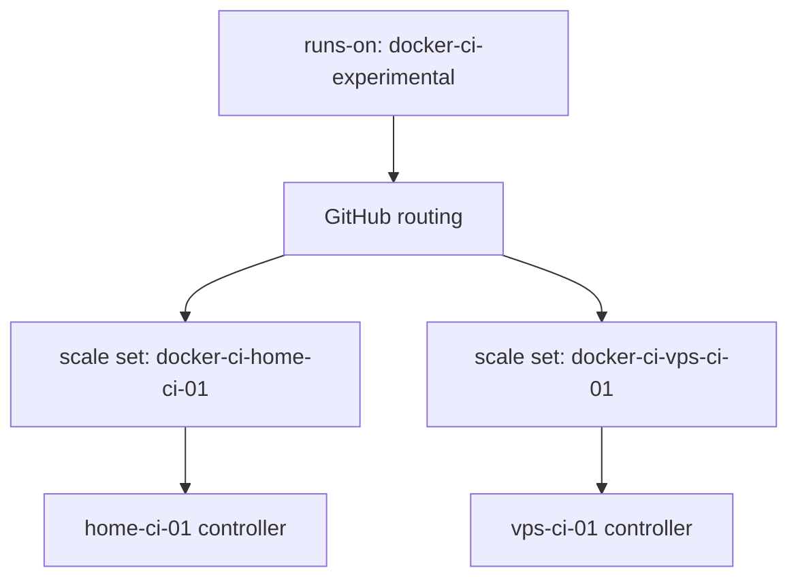

# Live pilot runbook

This runbook implements [issue #7](https://github.com/RandomDevelopment/ci-fleet/issues/7). It deliberately stops short of selecting a host, creating a GitHub App, or modifying a private project repository.

## Safety model

`ci-fleet` is public and must not receive access to the self-hosted runner group. GitHub warns that pull requests from forks of public repositories can potentially execute dangerous code on self-hosted machines. Copy the pilot workflow into exactly one trusted private repository and restrict the experimental runner group to that repository.

The runner has Docker socket access and must be treated as host-root-equivalent. The pilot must run on an isolated host with no production services, sensitive mounts, SSH agent, cloud metadata credential, or unrelated Docker workload.

## Fleet identity model

Every controller owns a unique scale set. Controllers share a routing label, which lets compatible jobs use any host without one controller deleting another host's scale set.



For the first pilot, deploy only one host:

```dotenv
CI_FLEET_INSTANCE=home-ci-01
CI_FLEET_SCALE_SET_NAME=docker-ci-home-ci-01
CI_FLEET_LABELS=docker-ci-experimental
CI_FLEET_MIN_RUNNERS=0
CI_FLEET_MAX_RUNNERS=1
```

## 1. Select the pilot repository and host

Choose one:

- a new private repository used only for the pilot; or
- one existing trusted private repository with the workflow limited to `workflow_dispatch`.

Do not change an existing required check. The host must be disposable and must not run production Docker workloads.

## 2. Create the organization runner group

In the organization settings, open **Actions → Runner groups** and create `trusted-private-ci-experimental`.

- Repository access: **Selected repositories**.
- Select only the pilot private repository.
- Do not override the default that prevents public repository access.

If the organization plan or UI does not permit a separate runner group, stop and record that limitation on issue #7. Do not silently place the pilot in a broadly accessible default group.

GitHub's current runner-group instructions are at <https://docs.github.com/en/actions/how-tos/manage-runners/self-hosted-runners/manage-access>.

## 3. Create the GitHub App

Create an organization-owned GitHub App. It does not need a webhook or callback URL for this controller.

Required permissions for organization-scoped runners:

- Repository permissions → Metadata: **Read-only** (automatic).
- Organization permissions → Self-hosted runners: **Read and write**.
- Repository Administration: **No access** for organization-scoped registration.

Install the App only on the target organization. Record its Client ID (the App ID also works with the pinned client) and installation ID. Generate one private key and transfer it directly to the pilot host. The official authentication instructions are at <https://docs.github.com/en/actions/how-tos/manage-runners/use-actions-runner-controller/authenticate-to-the-api>.

Do not paste the PEM into chat, an issue, a workflow secret, an environment variable, or a repository file.

## 4. Prepare host-local identity and reviewed policy

```bash
sudo install -d -m 0700 /etc/ci-fleet/secrets
sudo install -m 0600 -o root -g root DOWNLOADED-KEY.pem /etc/ci-fleet/secrets/github-app.pem
sudo install -m 0600 -o root -g root host/host.env.example /etc/ci-fleet/host.env
```

Edit `host.env` locally with the approved App identity and key path. Declare the
controller, experimental routing, `min_runners: 0` and `max_runners: 1` in reviewed
schema-v3 desired state. Use [adding a host](ADDING-A-HOST.md) for prerequisites.
The installer renders runtime configuration. Do not copy or hand-edit runtime
IDs from an example or another host.
For a new controller, follow the [first-install stages](DESIRED-STATE.md#install-a-fresh-controller).
Omit optional network/status/storage policy and keep active evidence empty until
the exact installed runtime is verified. Existing hosts retain their actual history.

## 5. Prepare image evidence without starting

Follow [managed images](MANAGED-IMAGES.md) on an authorized isolated build host.
Build only the actual reviewed merged engine, twice from clean state, and review
both role scalars for the target architecture into the approved configuration.
Portable sources require original config digests and root-side content binding;
`docker image inspect` alone is insufficient. Preserve old opaque-ID catalogs and
complete pending-sidecar predecessor staging when upgrading an existing host.

This runbook does not waive independent native classic/containerd validation or
host activation approval. The installer verifies both images before its own
publication and activation transaction.

## 6. Install at zero idle runners and observe

From the reviewed engine checkout, use the exact approved configuration commit.
Replace `home-ci-01` in every command below with the approved logical controller
identity from that configuration.

```bash
sudo ./scripts/install-worker-controller.sh --install \
  --config-repo example-org/fleet-config --ref APPROVED_FULL_CONFIG_COMMIT \
  --controller home-ci-01
sudo /opt/ci-fleet/manager/current/scripts/install-worker-controller.sh --check \
  --config-repo example-org/fleet-config --ref APPROVED_FULL_CONFIG_COMMIT \
  --controller home-ci-01
sudo docker logs --tail=100 ci-fleet-controller-1
sudo docker ps --filter label=io.randomdevelopment.ci-fleet.managed=true \
  --filter label=io.randomdevelopment.ci-fleet.instance=home-ci-01
sudo /opt/ci-fleet/manager/current/scripts/healthcheck.sh --json
```

Use the separately reviewed adoption or upgrade path for an existing installation.
With the reviewed minimum at zero, there must be no runner before a job dispatch.
Confirm the unique scale set is visible in the experimental runner group. The
installer must report `CONVERGED` and the exact-config check must report
`CHECK_OK`. `CHECK_STAGED` cannot prove first activation. Preserve only redacted
summaries outside Git. Integrate active evidence only after source review and
runtime verification, then add optional network policy in a later commit.

## 7. Run exactly one job

Copy `examples/workflows/live-pilot.yml.example` into the selected private repository. Commit it without changing existing CI, then manually dispatch it once.

Observe one runner container appear. After the job completes, confirm:

```bash
sudo docker ps -a --filter label=io.randomdevelopment.ci-fleet.managed=true \
  --filter label=io.randomdevelopment.ci-fleet.instance=home-ci-01
sudo systemd-run --wait --pipe --collect \
  --property=User=root \
  --property=EnvironmentFile=/etc/ci-fleet/ci-fleet.env \
  --property=WorkingDirectory=/opt/ci-fleet/current \
  /opt/ci-fleet/current/scripts/cleanup.sh --instance home-ci-01
sudo /opt/ci-fleet/manager/current/scripts/healthcheck.sh --json
```

Expected results: no runner container, no expired resource candidate, and healthy Docker/controller/disk checks.
The cleanup command is the managed [maintenance dry-run](HOST-MAINTENANCE.md#fleet-timers).
Systemd loads the protected rendered environment for that root process. Keep the
file root-owned mode `0600`; do not source it or credentials into the operator's
shell. Check cleanup's own successful result, since health alone does not prove
usable image bindings.

## 8. Roll back the pilot

Follow [managed retirement](DESIRED-STATE.md#drain-and-retirement). Merge a reviewed
configuration setting this controller to `drained`, then apply that exact commit
with the installed trusted manager:

```bash
sudo /opt/ci-fleet/manager/current/scripts/install-worker-controller.sh --upgrade \
  --config-repo example-org/fleet-config --ref APPROVED_FULL_DRAIN_CONFIG_COMMIT \
  --controller home-ci-01
sudo /opt/ci-fleet/manager/current/scripts/healthcheck.sh --json
sudo docker ps --filter label=io.randomdevelopment.ci-fleet.managed=true \
  --filter label=io.randomdevelopment.ci-fleet.instance=home-ci-01
```

Confirm the health report names the approved controller in `drained` state with
zero effective capacity and no active runner. Stop on a mismatch. Repeat Step 7's
cleanup dry-run while the rendered environment is still installed. Review its
output before authorizing the same cleanup command with `--apply`.

Then [uninstall the managed controller](DESIRED-STATE.md#check-upgrade-roll-back-and-remove):

```bash
sudo /opt/ci-fleet/manager/current/scripts/install-worker-controller.sh --uninstall
```

Uninstall reads the protected installed identity, drains, and removes controller
services and rendered state. Require `UNINSTALL_OK`, then verify the controller
and proxy are absent and the host's uniquely named scale set is absent from
GitHub before revoking credentials. Disable or remove the controller declaration
in a later reviewed configuration change. Remove the pilot workflow from the
private repository and revoke its runner-group access. Uninstall preserves host
identity, secrets and checkpoints for explicit disposition. If abandoning
ci-fleet, uninstall the App and securely delete the host PEM.

Existing downstream-consumer runner services remain unchanged throughout this pilot.
