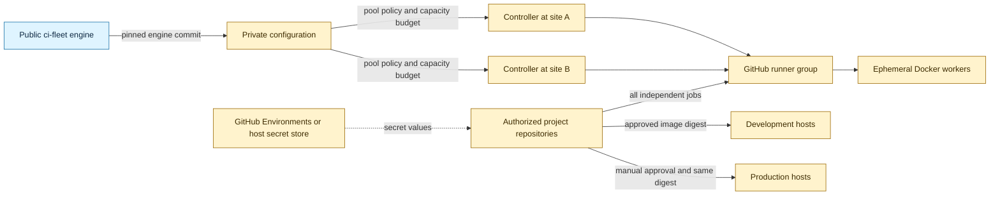
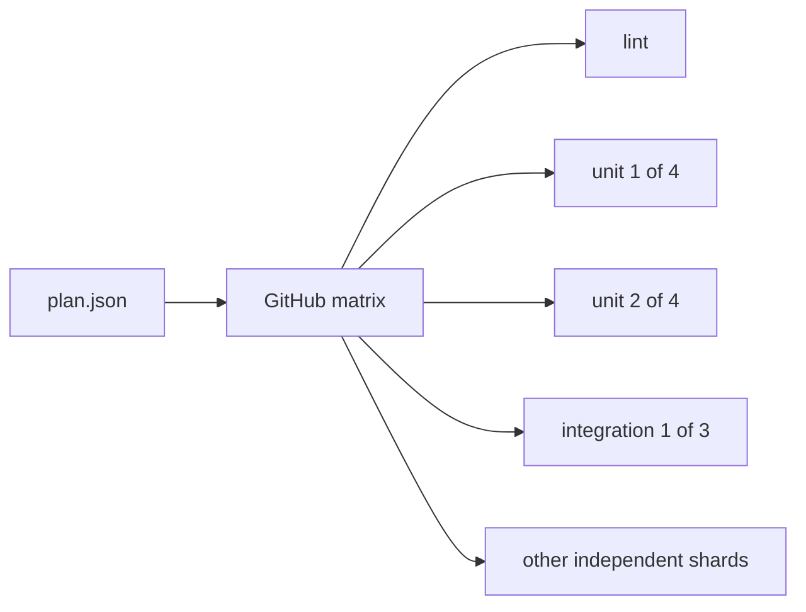

# ci-fleet configuration template

Optional host-local APT caching is available only after promoting an engine and
manager that support the `apt_cache` capability. It is disabled by default and
adds no desired-state schema field or endpoint to this repository. Configure it
locally using the engine's [APT cache guide](https://github.com/RandomDevelopment/ci-fleet/blob/main/docs/APT-CACHE.md).
Use reviewed image IDs for the selected engine, explicitly opt project builds
into secret mounts, and keep live acceptance separate from engine promotion.
Remove host cache settings before downgrading to an incompatible engine or manager.

Optional controller policy `docker_storage_retention: {"exclusive_fleet_daemon": true}`
admits image/default-builder cache reclamation on an isolated disposable-CI daemon.
Leave it absent until a compatible engine is active and existing storage has been
inventoried. See the [retention and activation contract](https://github.com/RandomDevelopment/ci-fleet/blob/main/docs/HOST-MAINTENANCE.md#docker-storage-retention).

The initializer, `fleet.json`, and `examples/multi-host/fleet.json` deliberately
omit this admission. First activate an engine advertising
`docker_storage_retention` and inventory each daemon. Then add the following
controller property in a separate reviewed change, only for controllers whose
entire daemon holds disposable ordinary-CI images and default-builder cache:

```json
"docker_storage_retention": {"exclusive_fleet_daemon": true}
```

For the multi-host example, assess each controller separately. A shared daemon
must leave this property absent; `false` is not a valid admission. Run
`./scripts/validate.sh --strict` after editing the private configuration.

This is the public, secret-free starting point for an organization's private `ci-fleet` configuration repository. It records which trusted projects may use each CI pool, the reviewed desired state for controller machines, infrastructure capacity budgets, logical deployment environments, and the standardized commands every project must expose.

It does **not** contain runner registration tokens, deploy credentials, private keys, host addresses, VM IDs, storage names, backup identifiers, or `.env` files.

One explicit exception permits reviewed operational Docker
`default_address_pools[].base` CIDRs and the optional `default_bridge_cidr`
gateway/interface CIDR in this private Git-authored policy. The controller must
render and inspect those exact Docker network ranges. They are not credentials,
host identity, or routable service endpoints. All VM, storage, backup, SSH,
rendered runtime, and unrelated infrastructure details stay outside Git.



## Start a private organization configuration

1. Create a **private** repository from this public template.
2. Clone it and initialize the first project and controller:

   ```bash
   ./scripts/init.sh \
     --organization your-org \
     --project your-app \
     --controller ci-01 \
     --location primary-site \
     --capacity-budget 1 \
     --max-runners 1 \
     --networks-per-runner 1 \
     --default-bridge-cidr 192.0.2.1/24 \
     --engine-ref REVIEWED_CI_FLEET_COMMIT \
     --architecture amd64 \
     --controller-image-digest sha256:REVIEWED_CONTROLLER_IMAGE_ID \
     --runner-image-digest sha256:REVIEWED_RUNNER_IMAGE_ID
   ```

3. Edit `fleet.json` to add the organization's real logical mappings and replace
   the generated RFC 5737 Docker network values with reviewed operational values.
4. Run the strict policy check:

   ```bash
   ./scripts/validate.sh --strict
   ```

5. Configure secret **values** in GitHub Environments, root-owned host files, or an external secret manager. The repository stores only names such as `DEPLOY_AUTH`.

The initializer refuses to replace a configured file unless `--force` is explicit. The product of `--max-runners` and `--networks-per-runner` cannot exceed 30, so its fictional `/24` pool never produces networks smaller than `/29` after reserving the controller and operator headroom. It runs non-strict validation because the generated documentation network values are intentionally not deployable. Run `./scripts/init.sh --help` for repository, registry, runner-group, controller, location, capacity, network, bridge, resource, and output options.

## Schema v3: Git-authored controller desired state

`fleet.json` is the reviewed authority for logical controller state. Each entry in `controllers` has a unique ID and declares:

- its runner pool and logical location;
- whether it is `active`, `drained`, or `disabled`;
- its unique GitHub scale-set name;
- an `experimental`, `stable`, or `retiring` lifecycle;
- the full reviewed ci-fleet commit SHA it runs;
- a zero managed minimum and reviewed maximum runner capacity;
- CPU and memory available to each ephemeral runner;
- Docker default-address pools, a positive reviewed maximum number of Compose
  networks per runner, and a reserved subnet count for health inspection.

`status_reporting` is deliberately omitted from initialized and reference
configurations. For an image-enforced controller, integrate the target engine's
reviewed capability record in `next-engine-rollout-evidence.json` before changing
`engine_ref`. In a later commit, select that engine and promote the matching
pending record unchanged into `engine-rollout-evidence.json`. Remove its pending
record, and remove the sidecar when empty. After routine reconciliation verifies
the selected runtime, add `status_reporting` in a later commit while retaining
the engine and active evidence. Enabling required delivery requires both
`status_reporting_config` and `required_status_reporting` to be `true` in the
previous integrated active record.

For image-free manager bootstrap, retain incumbent active evidence and the
matching pending records through manager staging and image-policy introduction.
Only after runtime verification promote evidence unchanged in an evidence-only
commit. This applies even when optional status/network fields are absent and all
capability flags are false. See [portable managed images and pending evidence](#portable-managed-images-and-pending-evidence).
Endpoint and key values remain host-local and never enter Git.

The same per-controller evidence record may declare
`docker_network_policy_config` and `docker_default_bridge_cidr_config`. A
controller may omit the first boolean only while it omits `docker_network_policy`.
It may omit the second while it omits `default_bridge_cidr`. Retained fields
require current evidence for the selected engine, and the selected engine
manifest must advertise the matching capabilities plus
`docker_network_policy_adapter`. Remove unsupported fields while retaining the
current engine, reconcile that release, and select an older engine only in a
later commit. A complete record has this shape after an operator has verified
the named engine is active:

```json
{
  "engine_ref": "1111111111111111111111111111111111111111",
  "status_reporting_config": false,
  "required_status_reporting": false,
  "docker_network_policy_config": true,
  "docker_default_bridge_cidr_config": true
}
```

The controller ID is how a target host selects its declaration. A location is a non-sensitive logical slug such as `primary-site` or `remote-site`, never an address. Runtime-generated configuration and credentials remain host-local.

### Pool capacity is infrastructure policy

Each runner pool has a `capacity_budget` and a runner group that must not be assigned to any other pool. Unique runner-group assignment keeps routing and repository authorization unambiguous. The semantic validator enforces this cross-object rule because JSON Schema cannot compare values stored in separate object properties.

The validator totals the maximum capacity of every active or drained controller assigned to the pool and rejects overcommit. Drained capacity remains reserved so an undrain cannot silently exceed the reviewed budget. Disabled controllers do not reserve capacity.

For `docker_network_policy`, each pool has an IPv4 CIDR `base` and Docker
subnet prefix `size`. The size must be no longer than `/29` and cannot be
broader than its base. A policy may declare at most 64 pools. Pools must not
overlap, and active or drained controllers must provide at least
`max_runners * networks_per_runner + reserve_subnets + 1`
subnets. The final subnet is reserved for the persistent controller Compose
network. The optional `default_bridge_cidr` is an IPv4 interface address and
prefix such as `192.0.2.1/28`, not a canonical network base. Its address must be
a usable gateway, its prefix must leave room for containers, and its subnet must
not overlap the default-address pools. After excluding the network, broadcast,
and bridge gateway addresses, it must provide at least
`max_runners + reserve_subnets` container addresses. Size this bridge for
containers that use Docker's default network. Size the pools separately for job and controller
networks. The pool-capacity arithmetic above does not change when the bridge
field is present.

Real values belong in the private configuration; this template uses RFC 5737
documentation ranges only. Non-strict validation accepts those public examples.
Strict validation rejects them until the private configuration uses a reviewed
operational Docker pool CIDR. This is the narrow capacity-policy exception
described above, not permission to commit host or service addresses.

The field is optional solely for staged upgrades from older schema-v3 engines.
For an image-enforced controller, first integrate matching target-engine pending
evidence with `docker_network_policy_config: true`. In a later commit, select the
compatible engine, promote that record unchanged into active evidence, and remove
the promoted pending record. After runtime verification, add the reviewed policy
in a later commit with the same ref and active evidence. The older engine rejects
the new key, so skipped commits must not satisfy the gate. Image-free bootstrap
uses the separate retention and evidence-only promotion sequence above.
Transition validation requires active evidence from the previous integrated state
when introducing policy. Retained policy also needs matching current evidence.
Adding `default_bridge_cidr` repeats the prior-state capability gate with
`docker_default_bridge_cidr_config: true`.

After the staged engine activation gate above, the pinned public engine
can apply or remove a validated policy with at most 64 pools. The executable
stage holds the installer lock, drains the controller and managed runners, and
changes Docker's `default-address-pools` key plus `bip` only when
`default_bridge_cidr` is configured. It preserves each prior key value, restarts
Docker, verifies the effective bridge subnet and gateway, probes capacity,
resumes the intended controller state, and checks health. Incompatible daemon
settings such as `fixed-cidr` fail before the drain. The transaction uses prior
key provenance and the prior rendered environment to roll back a failed or
interrupted operation, and retains recovery data if rollback cannot be verified.
A merged or configured policy does not authorize host mutation; rollout still
requires separate operator approval, exact-head CI, and proof for
the reviewed engine and desired-state commits. This stage does not create or
delete networks, prune resources, change controller scale or consumer labels,
or authorize application deployment.

Application repositories do not encode the number of available workers. They submit all independent tasks and shards. Do not use GitHub Actions `strategy.max-parallel` to model fleet size; controllers and the private configuration decide how many jobs run simultaneously. An application may limit concurrency only for a separately documented external-system constraint, not worker availability.

This separation lets one infrastructure change add, remove, drain, or resize controllers without editing every project workflow.

## Target-host installation and adoption

The public ci-fleet engine owns the host installer. Its intended interface consumes one logical controller from a pinned private configuration revision:

```bash
sudo ./scripts/install-worker-controller.sh \
  --config-repo example-org/example-fleet-config \
  --controller example-ci-01 \
  --ref <reviewed-config-commit> \
  --install
```

Use `--adopt` instead of `--install` to bring an existing controller under Git-authored desired state. The engine contract also provides `--check`, `--upgrade`, `--rollback`, and `--uninstall` modes.

The command runs on the target Linux Docker machine. It validates the pinned configuration, renders host-local runtime state, preserves root-owned secrets, drains before disruptive changes, verifies a recoverable checkpoint, installs maintenance services, checks health, and reports drift without exposing credentials. OpenClaw or another agent may invoke it, but no agent is required.

The engine-side implementation is `scripts/install-worker-controller.sh` in the parent ci-fleet repository. Its accepted scope is isolated ordinary-CI fleet hosts under reviewed schema-v3 desired state; this configuration repository never installs a controller by itself.

## Drain, retire, and delete a controller host

Host retirement is an explicit reviewed transition:

1. Change the controller state to `drained` and merge the private configuration change.
2. Converge the host and verify that it accepts no new work and has no active runner.
3. Remove only fleet-owned residue and verify replacement capacity.
4. Unregister its scale set and revoke that host's credentials.
5. Change the declaration to `disabled` or remove it in a later reviewed change.
6. Delete or repurpose the machine according to the installation's declared infrastructure policy.

Deleting one generic controller must not require application workflow changes. Legacy project-specific hosts should remain only until CI, promotion, and deployment no longer reference them.

## Hard rules

- Public repositories never receive direct access to the trusted self-hosted runner pool.
- Every project publishes `scripts/ci/plan.json` and implements `./scripts/ci/run.sh <task> --shard INDEX/TOTAL` in its own Docker-defined test environment.
- `./scripts/ci/run.sh fast` and `full` remain aggregate developer commands; fleet scheduling expands their named tasks across available workers.
- Every matrix job has a five-minute hard timeout, while expected test payload targets four minutes or less to reserve startup and reporting time.
- Application workflows submit all independent jobs; infrastructure configuration alone controls worker capacity.
- A GitHub runner group is assigned to exactly one runner pool.
- CI runner pools and deployment host groups are separate trust roles.
- Production deployment is manual and requires GitHub Environment approval.
- Controller engine revisions, reusable workflows, and third-party actions are pinned to immutable commits.
- Configuration contains logical identifiers only. Secret values, private host details, and credentials never enter Git.
- Promoted artifacts are container image digests; production does not rebuild a different image.

`fleet.schema.json` provides editor completion and structural documentation. `scripts/validate.py` is the authoritative dependency-free policy check, including cross-object relationships JSON Schema cannot express clearly.

## Five-minute parallelism contract

Projects divide their total test-minutes into independent named tasks and deterministic shards. Forty-five test-minutes require at least nine perfectly balanced five-minute jobs in theory. In practice, projects should create additional shards targeting four minutes of test payload so checkout, image preparation, and reporting remain inside the five-minute job ceiling.



Adding workers reduces wall-clock time only while independent shards remain queued. A genuinely indivisible test longer than five minutes must be optimized, split, or moved into an explicitly slower scheduled class outside ordinary CI.

## Repository map

| Path | Purpose |
|---|---|
| `fleet.json` | Fictional, valid schema-v3 configuration with one controller |
| `fleet.schema.json` | JSON Schema draft 2020-12 editor contract |
| `scripts/init.sh` | Safe first-project and first-controller initializer |
| `scripts/validate.sh` | Structural, relational, capacity, and secret-boundary validation |
| `scripts/test_policy.py` | Regression tests proving unsafe configurations fail closed |
| `examples/multi-host/fleet.json` | Fictional two-project, two-location controller topology |
| `SECURITY.md` | Secret handling and vulnerability reporting |
| `AGENTS.md` | Non-negotiable rules for humans and coding agents |

## Public and private boundary

| Safe in this public template | Belongs in the private config repo | Belongs only outside Git |
|---|---|---|
| Schema, validator, fictional examples | Real repository names and runner-group policy | Tokens, passwords, private keys |
| Standard CI entrypoint names | Logical controller IDs and locations | Host addresses, VM IDs, SSH material |
| Controller state and lifecycle vocabulary | Capacity budgets and per-runner limits | Rendered runtime configuration |
| Reusable engine interface | Required secret **names** | Secret values and application credentials |

The public engine and this template use the [Unlicense](LICENSE). See [THIRD_PARTY_NOTICES.md](THIRD_PARTY_NOTICES.md) before copying third-party material into a derived repository.

## Complete local validation and optional hosted checks

Use the reviewed engine's [complete configuration command](https://github.com/RandomDevelopment/ci-fleet/blob/main/docs/LOCAL-VALIDATION.md#configuration-repositories)
with explicit source, first-parent base and trusted engine revision. The command
includes policy tests, history secret scanning, transition checks and initializer
checks. `scripts/validate.sh --strict` remains a useful individual validator.
A complete trusted run and independent review remain separate requirements.

Use Linux with mounted `/proc`, Bash, Git, Python 3.11 or later, ShellCheck and
OpenSSL. The trusted launcher requires a prepared disposable Linux worker with systemd
255 or newer and cgroup v2. Run its account-preparation command from the selected
trusted engine checkout, then launch validation as root. Configuration stages
run as the locked unprivileged job account without Docker access. Missing
tools, unexpected skipped tests and interrupted checks fail a complete run.

For a root commit or initial push with no prior integrated state, pass
`--base 0000000000000000000000000000000000000000`. Preserve that value even
when imported history has parents. The report retains the zero base and records
`prior_integrated_state: false`. Commit policy has no range base, and secret
scanning covers every commit reachable from the source and original reviewed
head. Transition checks use empty prior controllers and no prior sidecar
evidence; the initial configuration cannot provide its own prior activation
evidence. Use real full commit SHAs for every other identity. Normal
applied-commit host verification still requires the real first-parent base and
signed evidence.

Hosted validation is disabled by default. Set repository Actions variables
`CI_FLEET_VALIDATOR_REVISION` to a full reviewed supporting engine commit and
`CI_FLEET_HOSTED_VALIDATION` to `true` to enable the convenience workflow. Set
`CI_FLEET_EXECUTOR_REVISION` to a different full reviewed executor commit
when the configuration validator retains an older baseline. The workflow checks
out and prepares that executor separately; otherwise it uses the validator revision.
Set `CI_FLEET_HOSTED_VALIDATION` to `false`, delete it, or remove
`.github/workflows/validate.yml` to disable
hosted execution. Local validation still works with Actions disabled or quota
blocked. Do not require this optional check merely because it is enabled.
The optional job is named `hosted-validation`; it never emits the old `validate`
check context, even when disabled. Keep any existing required `validate`
protection until a deliberate reviewed migration reconciles it. A skipped
convenience job cannot substitute for that required check. PR runs use the
target base SHA as base and main and pass the title as a quoted argument. For PR
events, the job requires an open PR. Title or target-base edits rerun validation
while the PR is open. Closed PR edits skip the job. Concurrency groups include
the event name and PR number or ref, so a
merged PR edit reporting the main ref cannot cancel main push validation. Push
runs use the source SHA as main and retain the event's base, including an
initial push's zero sentinel. Host policy-v1 keeps requiring hosted evidence
until separately migrated to the compatible signed-local policy. No workflow variable changes
host policy, and the public template receives no private runner access.


## Portable managed images and pending evidence

The scalar `managed_images` shape is unchanged. A selected runtime source with
`portable_managed_image_ids` requires original config digests from two clean builds
of the same reviewed merged source and architecture. Older engines keep exact
opaque Docker IDs. Never infer the kind from `sha256:` or rewrite historical
entries. Initializer digest flags accept the scalar appropriate to the selected
source. The public fixture catalog remains illustrative historical data.

Before engine selection, integrate a nonempty
`next-engine-rollout-evidence.json` with the same schema and controller map as
active evidence. Its engine refs must differ from incumbent runtime evidence.
Records may include boolean `portable_managed_image_ids` capability evidence.
Ordinary upgrades promote matching prior records unchanged and remove the empty
sidecar. Image-free manager bootstrap retains incumbent active evidence and
pending records through manager staging and image-policy introduction, then
promotes evidence alone after verified runtime activation. A no-change staging
commit remains invalid. Pass current and previous active/pending files together
with `--previous-config`; the engine callers use the immediate first parent.

The root installer derives runtime IDs and protected proof. Do not add them to
fleet policy or host inputs. See the engine's
[managed-image guide](https://github.com/RandomDevelopment/ci-fleet/blob/main/docs/MANAGED-IMAGES.md)
for build evidence, limits, cache refresh, cleanup and recovery. A published engine
or template does not establish native import or host acceptance. Standalone
template publication, adopter promotion and live rollout remain separate gates.
